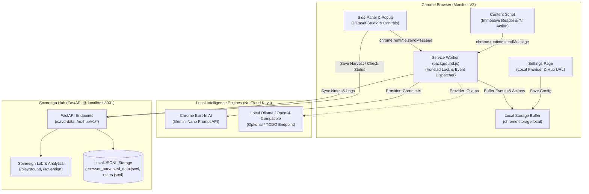

# ✨ NepaChrome: Sovereign AI Research Workstation & Chrome Extension

[](https://developer.chrome.com/docs/extensions/mv3/intro/)
[](https://fastapi.tiangolo.com)
[](#-privacy--offline-resilience)
[](#-zero-cloud-keys-architecture)
[](LICENSE)

**NepaChrome** is a professional-grade, privacy-first ecosystem designed for Devanagari NLP experimentation, bilingual reading immersion, and automated dataset synthesis. Powered by **Chrome Built-In AI (Gemini Nano)** and accompanied by a lightweight **FastAPI** local hub, NepaChrome transforms your browser into a self-contained intelligence workstation without requiring third-party cloud API keys or transmitting telemetry.

---

## 🌟 Key Capabilities

### 1. 🌐 Immersive Bilingual Reading
- **Inline Parallel Reading**: Automatically injects high-fidelity Nepali translations directly beneath English paragraphs on any website.
- **Serial Request Queue**: An ironclad execution lock processes segments sequentially, preventing NPU/GPU saturation.
- **Atomic RunIDs**: Dynamically terminates background translation loops on page navigation or refresh, preventing orphaned ghost loops.

### 2. ⚡ Minimalist "N" Quick-Action Bubble
- Select text on any web page to invoke the floating **"N"** trigger.
- Instant actions:
  - **Translate to Nepali** (preserves domain-specific nomenclature).
  - **Summarize Selection** (concise prose extraction).
  - **Save as Research Note** (buffered locally and synced to hub).
  - **Custom Instruction** (interactive prompt runner).

### 3. 🛡️ Offline-Resilient Data Logging & Buffering
- **Zero Data Loss Guarantee**: All research actions, translations, notes, and harvested pairs are immediately logged to local browser storage (`chrome.storage.local`).
- **Offline Backend Notifications**: If the FastAPI server is not active, the extension clearly alerts the user and safely buffers records locally.
- **One-Click Batch Sync**: When the server is online, a single click syncs all buffered items to the local JSONL archives via `/nc-hub/v1/sync`.

### 4. 📊 Synthetic Dataset Harvester (JSONL)
- Automatically synthesize unstructured Devanagari text into structured instruction-response pairs formatted for LLM fine-tuning and LoRA adapters.
- Diversity rules enforce factual, analytical, and synthetic question types.

### 5. 🧪 Sovereign AI Lab (Playground)
- Full-screen Material 3 research lab hosted locally at `http://localhost:8001/playground`.
- Live model diagnostics, interactive module switcher (Chat, Summarize, Translate, Proofread), and one-click chat history archival.

---

## 🏗️ Architecture



---

## ⚡ Quick Start Guide

### 1. Prerequisites
- **Chrome Desktop** (v138+ recommended for Built-in AI Prompt API).
- **Python 3.10+** (for the local Sovereign Hub).

---

### 2. Install the Chrome Extension
1. Open Google Chrome and navigate to `chrome://extensions`.
2. Enable **Developer mode** in the top-right corner.
3. Click **Load unpacked** and select the [`extension/`](extension/) directory from this repository.
4. The **NepaChrome** icon will appear in your extensions toolbar.

---

### 3. Launch the Sovereign Hub Backend
The backend provides persistent JSONL storage, research metrics, and the full-screen AI Playground:

```bash
# 1. Navigate to the server folder
cd server

# 2. Install dependencies (standard & minimal)
pip install -r requirements.txt

# 3. Start the server
python main.py
```

The server starts at `http://localhost:8001`:
- 🧪 **AI Lab Playground**: [http://localhost:8001/playground](http://localhost:8001/playground)
- 📊 **Harvest Dashboard**: [http://localhost:8001/](http://localhost:8001/)
- 🌐 **Sovereign Metrics**: [http://localhost:8001/sovereign](http://localhost:8001/sovereign)
- 📖 **Interactive API Docs**: [http://localhost:8001/nc-hub/docs](http://localhost:8001/nc-hub/docs)

*(Note: If you run the extension without the server, all notes and harvested pairs are safely buffered inside your browser's local extension storage until you start the hub).*

---

### 4. Enable Chrome Built-In AI (Gemini Nano)
To run inference via Chrome's native on-device model:
1. Navigate to `chrome://flags` in your browser.
2. Search for and enable:
   - `#optimization-guide-on-device-model` -> **Enabled (BypassPerfRequirement)**
   - `#prompt-api-for-gemini-nano` -> **Enabled**
   - `#summarization-api-for-gemini-nano` -> **Enabled** (optional)
   - `#translation-api` -> **Enabled** (optional)
3. Relaunch Chrome. Open `http://localhost:8001/playground` to verify diagnostics turn **Available**.

---

## 🔒 Zero Cloud Keys & Local Sovereignty

NepaChrome is built from the ground up to require **zero external API keys** (no OpenAI, Anthropic, or external credentials):
- **Primary Engine**: Google Chrome Built-in AI Prompt API (`LanguageModel` / `window.ai.languageModel`).
- **Modular Alternative (TODO / Optional)**: Local Ollama / OpenAI-compatible endpoint (configurable via Extension Settings to point to `http://localhost:11434/v1` with models such as `llama3.2` or `mistral`).
- **Telemetry-Free**: Data never leaves `localhost`. All JSONL archives remain strictly on your local filesystem.

---

## 📂 Repository Structure

```
chrome_llm_test/
├── extension/                     # Manifest V3 Chrome Extension
│   ├── manifest.json              # Extension manifest & permissions
│   ├── background.js              # Service worker & request serializer
│   ├── content.js                 # In-page DOM injector & "N" action menu
│   ├── popup.html / popup.js      # Quick controls & sync status badge
│   ├── sidepanel.html / .js       # AI Center & synthetic dataset studio
│   ├── settings.html / .js        # Provider, Ollama, & hub configuration
│   ├── styles.css                 # Clean CSS styling
│   ├── icon.png                   # Extension icon
│   ├── modules/
│   │   ├── ai-engine.js           # Universal local AI resolver (Nano + Ollama)
│   │   ├── api-client.js          # Hub sync & offline storage buffer
│   │   ├── logger.js              # Formatted diagnostic logger
│   │   ├── modes-config.js        # Prompt templates & mode definitions
│   │   └── ui-components.js       # Shadow DOM UI component factory
│   └── prompts/                   # Structured prompt engineering modules
│       ├── dataset.js             # Instruction-response generation
│       ├── suggest.js             # Contextual research chips
│       ├── summary.js             # Recursive summarizer
│       └── translate.js           # Semantic Devanagari translation
│
├── server/                        # Lightweight FastAPI Research Hub
│   ├── main.py                    # API routes, CORS, and Sovereign engine
│   ├── requirements.txt           # Minimal backend dependencies
│   ├── browser_harvested_data.jsonl.example # Example training pair schema
│   ├── notes.jsonl.example        # Example research note schema
│   ├── playground_history.jsonl.example     # Example session schema
│   └── templates/
│       ├── dashboard.html         # Live stats & notes viewer
│       ├── playground.html        # Sovereign AI Lab & diagnostics
│       └── sovereign_dashboard.html # Domain synergy radar chart
│
├── docs/                          # Technical Documentation & Guides
│   ├── architecture.md            # Deep dive into security & CSP isolation
│   ├── features.md                # Feature blueprint & navigators
│   ├── llm_guidelines.md          # Sovereign LLM prompting guidelines
│   └── troubleshooting.md         # Problems faced & engineering resolutions
│
├── .gitignore                     # Clean GitHub ignore rules (venv, logs, data)
├── LICENSE                        # The Unlicense (Public Domain)
└── README.md                      # Project documentation (this file)
```

---

## 📚 Technical Documentation

Explore the in-depth documentation in [`docs/`](docs/):
- **[Architecture & Deep Dive](docs/architecture.md)**: Solving CSP barriers, Shadow DOM injection, and memory management.
- **[Feature Blueprint](docs/features.md)**: Detailed breakdown of the Immersive Engine, Playground, and Ingestion pipelines.
- **[LLM Guidelines](docs/llm_guidelines.md)**: Prompting standards for Devanagari linguistic fidelity and Chain-of-Thought reasoning.
- **[Troubleshooting Guide](docs/troubleshooting.md)**: Resolving namespace volatility, port conflicts, and model download buffers.

---

## 📜 License

This project is released into the public domain under the [The Unlicense](LICENSE). You are free to copy, modify, distribute, or build upon this software for any purpose.
